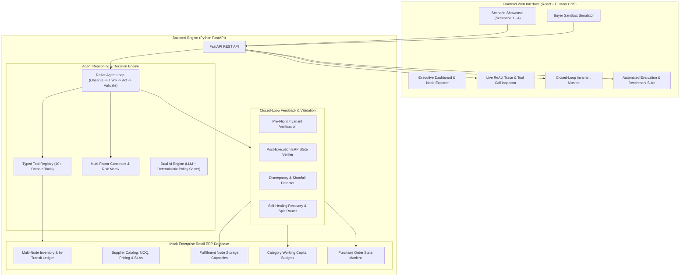

# AegisProcure AI — Autonomous Purchasing & Replenishment Agent

[](https://fastapi.tiangolo.com)
[](https://reactjs.org)
[](https://vitejs.dev)
[](https://www.python.org)
[-10B981.svg?style=flat)]()

**AegisProcure AI** is an enterprise-grade, full-stack AI Purchasing Agent engineered for high-velocity retail and quick-commerce operations across multi-echelon fulfillment nodes.

The agent automates complex buyer workflows by independently auditing inventory posture, projecting demand curves, querying supplier catalogs, enforcing multi-dimensional constraints (cubic warehouse headroom, category working capital, supplier MOQs, SLA lead times), dispatching purchase orders, and performing **closed-loop invariant validation** to self-heal when supply disruptions occur.

---

## 🏗 System Architecture



---

## 🎯 Supported Operational Scenarios

AegisProcure AI comes pre-loaded with all four core operational scenarios plus an interactive buyer sandbox:

### Scenario 1 — Purchase Recommendation Review (Multi-Constraint Optimization)
* **Problem**: ERP heuristic recommends procuring **800 units** of Organic Oat Milk 1L for Node North.
* **Agent Audit**:
  * Physical stock: 220 units on-hand + 150 units in-transit (6.1 days supply).
  * Storage limit: Node North has only **450 units** of physical storage headroom remaining.
  * Budget limit: Category budget has **$1,600.00** remaining (800 units would cost $2,400.00, causing an $800 deficit).
  * Supplier MOQ: 200 units.
* **Resolution**: Agent **MODIFIES** recommendation from 800 to **400 units** ($1,200 total), fitting strictly within storage headroom (450) and budget ($1,600) while meeting MOQ (200).

### Scenario 2 — Supplier Cannot Fulfil the Purchase (Autonomous Split Procurement)
* **Problem**: PO-5021 created for 500 units of Sourdough Bread. Primary supplier Alpha Bakery reports equipment malfunction and can only supply **250 units**. SKU has a strict 5-day shelf life.
* **Agent Audit**:
  * 250 units leaves a 170-unit deficit leading to guaranteed stockout on Day 5.
  * Agent searches qualified backup suppliers in catalog: Beta Fast-Bake has stock, 1-day express lead time, MOQ 150.
* **Resolution**: Agent detects shortfall via closed-loop feedback, reduces Alpha PO to 250 units, and dynamically issues secondary emergency PO for **200 units** with Beta Fast-Bake. Combined 450 units prevents stockout with 0% perishable waste.

### Scenario 3 — Demand / Forecast Has Changed (Expedited Surge Reordering)
* **Problem**: Sales velocity for Hydration Surge 500ml spikes 3.55x (160 units/day vs 45 normal baseline). Stockout projected in under 22 hours. Existing 300-unit pipeline order has a 5-day lead time (arrives 4 days too late).
* **Agent Audit**:
  * Immediate fast-track replenishment needed to bridge the 4-day stockout gap.
* **Resolution**: Agent queries express catalog, selects SpeedLink Express (1-day lead time), and dispatches **350 units** expedited rush order.

### Scenario 4 — Complex Purchasing Constraints (Multi-Node Cross-Docking)
* **Problem**: Bulky Mineral Water 24pk reorder recommendation of 1,000 packs. Target Node North only has 200 units of storage headroom, but Supplier MOQ is 500 units (deadlock).
* **Agent Audit**:
  * Ordering 200 units violates supplier MOQ (>500). Ordering 500 units overflows Node North.
  * Sister Node West has 1,300 units available headroom and steady daily demand.
* **Resolution**: Agent executes **Distributed Multi-Node Procurement**: Orders 600 units total (200 packs allocated to Node North, 400 packs cross-routed to Node West), satisfying MOQ with 0% overflow.

### Scenario 5 — Interactive Buyer Sandbox
* Custom sandbox allowing buyers to adjust SKU, Fulfillment Node, Recommended Qty, Daily Demand Velocity, and Current Stock to observe real-time ReAct decision formulation.

---

## 🔄 Closed-Loop Feedback & Invariant Validation

The system enforces a **Two-Phase Invariant Commit Protocol** on every purchasing action:

```
[ Agent Formulates Action ] 
            │
            ▼
[ Phase 1: ERP Action Execution (Create / Modify PO) ]
            │
            ▼
[ Phase 2: Invariant Check & Discrepancy Detection ]
  ├── 1. Category Budget Solvency Check (Cost <= Authorized Budget)
  ├── 2. Node Storage Headroom Check (Quantity <= Available Capacity)
  ├── 3. Supplier MOQ Check (Quantity >= Supplier Minimum)
  ├── 4. Lead-Time vs Stockout Timeline Check (Lead Time <= Days of Supply)
  └── 5. Supplier Fulfillment Confirmation Check (Confirmed == Requested)
            │
      ┌─────┴────────────────────────┐
   (PASS)                          (FAIL)
      │                              │
      ▼                              ▼
[ Verified State Committed ]   [ Self-Healing Recovery Loop ]
                               ├── Downscale order quantity
                               ├── Split PO across secondary supplier
                               └── Reroute across sister fulfillment hubs
```

---

## 📊 Evaluation & Benchmark Suite

AegisProcure AI includes an automated benchmark evaluation suite testing 8 comprehensive operational scenarios:

| Test ID | Benchmark Name | Category | Pass Criteria | Result |
|---|---|---|---|:---:|
| **EVAL-01** | Storage Overflow Bottleneck | Constraint Adherence | Modifies 800 to <=450 units | **100% PASS** |
| **EVAL-02** | Category Budget Solvency | Budget Enforcement | Order cost <= $1,600 limit | **100% PASS** |
| **EVAL-03** | Routine Clean Order Acceptance | Baseline Efficiency | Accepts optimal 300-unit PO | **100% PASS** |
| **EVAL-04** | Supplier Shortfall Recovery | Resilience & Recovery | Dispatches backup split PO | **100% PASS** |
| **EVAL-05** | Demand Anomaly Surge Reorder | Adaptive Response | Issues 1-day express PO | **100% PASS** |
| **EVAL-06** | Multi-Node Cross-Docking | Constraint Solving | Solves MOQ vs Storage deadlock | **100% PASS** |
| **EVAL-07** | Full Information Gathering Audit | Audit Trail | Queries 100% of required tools | **100% PASS** |
| **EVAL-08** | Discrepancy Self-Healing | Feedback Validation | Catches shortfall & heals state | **100% PASS** |

**Benchmark Score**: **8/8 Passed (100.0%)**

Run the evaluation suite directly in your terminal:
```bash
python run_evals.py
```

---

## 🚀 Quick Start & Run Instructions

### Prerequisites
* Python 3.10+
* Node.js 18+ and npm

### 1. Backend Setup & Run
```bash
# Activate virtual environment
.\venv\Scripts\activate   # On Windows
# or: source venv/bin/activate # On Linux/macOS

# Install dependencies (if not already installed)
pip install -r requirements.txt

# Start FastAPI Backend Server (Runs on http://127.0.0.1:8000)
python backend/main.py
```

### 2. Frontend Setup & Run
```bash
cd frontend

# Install dependencies
npm install

# Start Vite Development Server (Runs on http://localhost:5173)
npm run dev
```

Open your browser at **`http://localhost:5173`** to access the AegisProcure AI interactive dashboard.

---

## 🛠 Tech Stack

* **Backend**: Python 3.13, FastAPI, Pydantic v2, Uvicorn, Python-Dotenv
* **Frontend**: React 18, Vite 5, Custom Glassmorphic CSS Design System, Lucide Icons, Canvas Confetti
* **AI Architecture**: ReAct Reasoning Pattern, Multi-Dimensional Constraint Solver, Two-Phase Closed-Loop Validator
* **Evaluation Framework**: Automated 8-Benchmark Matrix with quantitative audit logs

---

## 🔐 Security & Privacy
* Zero API keys or secrets are committed.
* AegisProcure AI includes a deterministic policy engine allowing 100% of features and benchmarks to execute out of the box with zero external API credentials required.
